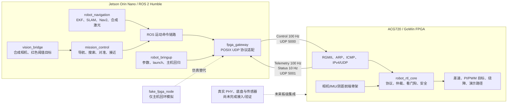

# GoWin 机器人项目现状说明

> 静态审阅快照：2026-08-26  
> 审阅范围：本目录下的 `FPGAGowin2026`、`fpga_rtl`、`fpga_gateway`、`robot_bringup` 四个仓库。  
> 方法与边界：本文基于源码、启动文件、协议文档和提交历史整理；本次审阅**没有**在当前 Windows 环境重新构建 ROS、运行 RTL 仿真、执行 Gowin P&R 或连接任何硬件。文中“已通过”的测试/时序结论均明确标注为仓库内 2026-08-24 交接文档记录，而不是本次复测结果。

## 一句话结论

这是一个面向 2026 年现场演示的两轮差速具身机器人原型：**ACG720 GoWin FPGA**承担确定性网络接入、实时运动/安全裁决和未来的底层外设接入；**Jetson Orin Nano**运行 ROS 2 Humble，承担融合、SLAM、Nav2、视觉和任务决策。二者通过固定的千兆以太网 UDP 二进制协议协作。

当前工程已经形成了“FPGA 纯 RTL 仿真 + Jetson ROS 主机仿真 + 固定协议 + 离线 Gowin 时序验证”的可开发基线；但它还不是已完成实板或实车的系统。实际 PHY/PCB 时序、最终引脚、电机/编码器、物理急停、真实 IMU/测距/相机以及整车安全闭环均未完成验证。

项目自带的完成度报告（更新于 2026-08-24）按最终现场演示门槛估计约为 **38%**。这是项目自己的历史工程估计，不是本次审阅重新计算的百分比。

## 当前检出版本

| 仓库 | 分支与提交 | 本次工作树检查 | 主要职责 |
|---|---|---|---|
| [`FPGAGowin2026`](FPGAGowin2026/README.md) | `main` / `a5a6ebe2bf2b` | 干净 | 总体方案、接口文档、依赖脚本、导航/视觉/任务 ROS 包 |
| [`fpga_rtl`](fpga_rtl/README.md) | `main` / `79224008cb8a` | 干净 | ACG720 Verilog RTL、仿真、Gowin 工程与离线 wrapper |
| [`fpga_gateway`](fpga_gateway/README.md) | `main` / `88f760c70187` | 干净 | Jetson/ROS 与 FPGA 之间的 C++17 UDP 网关及主机模拟器 |
| [`robot_bringup`](robot_bringup/README.md) | `main` / `c188c9934bc6` | 干净 | 网关参数、仿真/硬件 launch 与主机闭环测试 |

父仓库不是单体仓库：它把稳定的 FPGA、网关和 bringup 分拆到三个私有仓库；导航、视觉和任务控制原型仍直接放在 `FPGAGowin2026/ros_ws/src/robot/` 中。

## 系统现在在做什么



### 两种运行模式

- **FPGA 独立模式**：FPGA 内部路径段和局部绕障产生运动目标；Jetson 的运动命令应被忽略。
- **Jetson 协同模式**：Jetson 的导航/任务链路给出高层运动命令；FPGA 只保留限幅、减速、停车、看门狗、急停和严重故障等最终安全裁决。
- 不论模式如何，物理急停、严重故障和安全停车优先级最高。模式切换要求先清零目标并确认停车，避免两个命令源同时驱动底盘。

这一模式隔离是当前架构的安全核心，而不是普通的软件功能开关。

## 四个仓库如何协作

### 1. `FPGAGowin2026`：总控、工作区入口和高层 ROS 原型

该仓库保存总体方案、[交接文档](FPGAGowin2026/docs/handoff.md)、[UDP 协议](FPGAGowin2026/docs/udp_protocol.md)及两个同步脚本：

- [`Scripts/sync_fpga_workspace.sh`](FPGAGowin2026/Scripts/sync_fpga_workspace.sh) 会把 `fpga_rtl` 克隆或快进到父仓库内的 `FPGA_ws/`。
- [`Scripts/sync_ros_packages.sh`](FPGAGowin2026/Scripts/sync_ros_packages.sh) 会把 `fpga_gateway` 和 `robot_bringup` 放入 `ros_ws/src/robot/`。
- 当前本地工作区是四个并列克隆，尚未执行上述脚本，因此父仓库内对应同步目录并不存在。这是目录布局差异，不代表缺少这三个仓库。

父仓库直接维护三项高层 ROS 2 C++17 原型：

| 包 | 当前代码功能 | 现阶段限制 |
|---|---|---|
| [`robot_navigation`](FPGAGowin2026/ros_ws/src/robot/robot_navigation) | 通过 `robot_localization`、`slam_toolbox`、Nav2 组织融合、建图和导航；自带 `sim_laser_node`，在矩形房间与圆形障碍物中根据轮式里程计生成合成 `/scan`。 | 不含真实激光雷达、真实 IMU/TF 外参或实车标定。导航依赖以本地 ROS Humble 覆盖层安装，不提交到 Git。 |
| [`vision_bridge`](FPGAGowin2026/ros_ws/src/robot/vision_bridge) | `synthetic_camera_node` 从里程计生成合成 RGB 图像；`red_target_node` 以红色阈值、面积占比和图像中心偏差发布 `/vision/target_observation`。 | 这是可替换的颜色阈值基线，不是 TensorRT、神经网络、真实相机或训练模型证明。 |
| [`mission_control`](FPGAGowin2026/ros_ws/src/robot/mission_control) | 用 Nav2 先到搜索点，再搜索、视觉对准、接近目标并停车；状态流为 `WAITING_NAV → NAVIGATING → SEARCHING → TRACKING → COMPLETE`。急停会取消导航、发布零速度并进入 `STOPPED`。 | 视觉接近与导航命令需要在实际 ROS 部署中接入唯一的速度平滑/仲裁链路；真实机器人上的话题映射和安全验证尚未完成。 |

完整无硬件仿真入口是：

```bash
ros2 launch mission_control simulation.launch.py
```

它组合本机 FPGA 模拟、合成激光、SLAM/Nav2、合成相机、红色目标识别与任务状态机。该入口证明的是主机侧软件闭环，不会访问 FPGA、电机或外部传感器。

### 2. `fpga_gateway`：Jetson 与 FPGA 的网络边界适配器

这是 Linux/Jetson 目标上的 ROS 2 Humble C++17 包，使用 POSIX 非阻塞 UDP；不是 FPGA 工程、串口/CAN 驱动或板级驱动。

`fpga_gateway_node` 的职责是：

- 订阅 `/cmd_vel` 和 `/emergency_stop`；
- 把 `linear.x`、`angular.z` 和软件急停编码为 UDP Control；
- 无论目标速度是否为零，按 100 Hz 发出控制/心跳；
- 命令超时、未收到命令或软件急停时持续发送零速度；
- 解析 FPGA 返回的 Telemetry/Status，发布轮式里程计、IMU、关节状态、三路测距和 `/fpga/status` 诊断。

`fake_fpga_node` 是主机 UDP 回环用的理想差速底盘模拟器，支持命令看门狗以及丢包/CRC 损坏注入。它用于测试网关和 ROS 闭环，**不代表** RTL、RGMII、PWM、电机或实车行为。

### 3. `robot_bringup`：统一参数、仿真与部署入口

该仓库把可变部署参数集中在 [`config/fpga_gateway.yaml`](robot_bringup/config/fpga_gateway.yaml) 中，包括端点、频率、超时、轮式里程计初值、坐标系和协方差初值。

- [`fpga_sim.launch.py`](robot_bringup/launch/fpga_sim.launch.py) 同时启动网关与 `fake_fpga_node`，默认使用 `127.0.0.1:15000/15001`。
- [`fpga_hardware.launch.py`](robot_bringup/launch/fpga_hardware.launch.py) 只启动真实网关，默认假设 FPGA 为 `192.168.50.2`，控制/遥测端口为 `5000/5001`。
- [`test_fpga_sim_control.py`](robot_bringup/test/test_fpga_sim_control.py) 在独立 ROS domain 与本机 UDP 回环中检查约 100 Hz 遥测、命令超时归零、软件急停、解除急停后必须有新命令才能恢复，以及模拟端退出后的链路离线诊断。

YAML 中的轮距、轮半径、编码器分辨率、协方差和坐标系参数目前是主机仿真/融合起点，必须由真实静止、直行和定点旋转数据重新标定。

### 4. `fpga_rtl`：可综合的网络、安全与运动 RTL 骨架

该仓库的目标是 ACG720 `GW5AT-LV138PG484AC1/I0` 上的机器人 FPGA 原型。其数据路径为：

1. RGMII/GMII 接收 IPv4/UDP 控制报文；
2. 验证以太网 FCS、IPv4/UDP 检查、目标端点和应用层 CRC；
3. 以深度 4 的完整记录 CDC FIFO 将合法 Control 交给 `robot_rtl_core`；
4. `robot_rtl_core` 执行模式仲裁、命令看门狗、测距安全限制和运动骨架；
5. 编码 72 字节 Telemetry、38 字节 Status，经 CDC FIFO、ARP/最小 ICMP 和 RGMII 发回 Jetson。

代码已包含以下逻辑层：

- 固定二进制协议的 Control 解析、CRC16、长度/版本/序号拒绝及回绕处理；
- 最小 ARP responder 和最多 64 字节的 ICMP Echo Reply；
- 100 Hz Telemetry、10 Hz Status 调度与发送仲裁；
- 软件/物理急停、严重故障、Control 看门狗、模式切换保护；
- 前距安全限制：前方很近时停车、接近时降低前进速度；
- AB 正交解码、轮速估计、差速运动学、双轮 PI/PWM 目标、局部绕障、四段 ROM 演示路径；
- OV5640 DVP RGB565、IMU 字节组帧、三路测距有效性检查等传感器前端。

但“逻辑存在”不等于“硬件已经接好”：

- 机器人网络顶层保留了抽象的传感器/轮速输入；电机 PWM 与方向输出尚未连到最终板级端口。
- OV5640 只完成像素采集前端；寄存器配置、I2C/SPI/TOF 协议、CDC、DDR3、HDMI 未实现。
- 当前 14-I/O 离线 wrapper 只使用已知官方 RGMII/复位管脚，未知输入设为失效安全常量，并使用离线 `/2` 系统时钟；它不是最终上板顶层。
- 尚无 PHY reset、MDIO、链路状态或根据真实 PHY/PCB 数据填写的 RGMII 输入/输出延迟约束。

## 已冻结的 UDP 接口

协议源文件为 [`FPGAGowin2026/docs/udp_protocol.md`](FPGAGowin2026/docs/udp_protocol.md)，C++ 网关和 Verilog RTL 都按该字段逐项编解码，而不是直接复制 C/C++ 结构体。

| 项目 | 当前定义 |
|---|---|
| 字节序 | 网络字节序（大端） |
| 公共头 | 20 字节，含 `FPGA` magic、版本、消息类型、载荷长度、序号、微秒时间戳 |
| 完整性 | 2 字节 CRC16-CCITT-FALSE，错误 magic/版本/类型/长度/CRC 一律丢弃 |
| Control | 类型 1，总长 31 字节；线速度 `int32 mm/s`、角速度 `int32 mrad/s`、软件急停 flag |
| Telemetry | 类型 2，总长 72 字节；编码器、轮速、IMU、三路距离与状态位 |
| Status | 类型 3，总长 38 字节；模式、运动使能、急停、安全停车、故障位、运行时间和最后控制序号 |
| 默认网络 | Jetson `192.168.50.1/24`、FPGA `192.168.50.2/24`；Control 至 UDP 5000，Telemetry/Status 至 UDP 5001 |
| 目标频率 | Control 100 Hz、Telemetry 100 Hz、Status 10 Hz |

网关的软件急停和链路诊断只是主机侧安全层。真实 PHY、FPGA 报文心跳和 PWM 关闭仍必须由 FPGA/硬件独立裁决。

## 当前验证到什么程度

### 代码与主机仿真层

仓库内交接文档记录，在 2026-08-23/24 的 Linux 环境中：

- 4 项 UDP 协议 GTest 通过：黄金 Control、三类报文往返、畸形包拒绝、序号回绕；
- 1 项主机 UDP launch 回归通过：遥测节拍、速度命令、超时归零、急停、安全恢复、模拟链路断开；
- `robot_navigation`、`vision_bridge`、`mission_control` 各有 C++ 算法 GTest；
- 5 个 ROS 包构建成功，8 个直接测试用例通过；`colcon test-result` 中的 13 条记录含 CTest 包装层汇总，不能误称为 13 个独立测试；
- 同轮主机仿真记录了融合里程计、`120 × 80 @ 0.05 m/pix` 地图、Nav2 从 `(0,0)` 到 `(1,0)`，以及任务状态到达 `COMPLETE`。

这些是已提交文档中的历史证据；本次仅做静态检查，未在本机重跑。

### RTL 与离线实现层

交接文档还记录：

- `fpga_rtl/Scripts/run_all_sim.sh` 统一包含 10 个 RTL 功能自检和 1 个 Gowin PLL/RGMII 顶层展开检查；
- 端到端网络 testbench 覆盖 ARP、ICMP、Control/Telemetry/Status、坏 FCS/IP/UDP/应用 CRC、端点与序号拒绝、CDC FIFO 满、看门狗、急停、故障和异步复位；
- Gowin 商业版已对官方 UDP 回环、机器人网络顶层和 14-I/O 离线 wrapper 完成综合；离线 wrapper 的内部时钟 P&R/STA 文档记录为 125 MHz 目标、setup/hold 违规为 0。

这些结论**不能**外推为以下结果：真实 RGMII 板级时序、PHY 断链、最终 GPIO/PWM、物理急停、电机、传感器、实车安全、长时稳定运行或现场演示已经通过。

## 目前最重要的缺口与下一步

项目的关键路径已经不是继续堆叠通用算法，而是把现有原型收敛为真实板级系统：

1. 固化电机驱动、编码器、IMU、三路测距、OV5640、激光雷达、PHY 的真实型号，以及 ACG720 引脚、电平、电流、时钟和复位表。
2. 基于真实 PHY 时钟关系和 PCB 延迟补齐 RGMII 约束，派生最终板级顶层，再重新执行 P&R/STA。
3. 保持电机驱动禁用，先上板验证 RGMII、ARP、Ping、UDP Control/Telemetry/Status 和 Jetson–FPGA 黄金报文。
4. 架空车轮验证物理急停、看门狗、PWM、方向、编码器、限幅和堵转；确认安全后才允许落地闭环。
5. 接入真实 IMU、测距、相机、DDR3/HDMI 和激光，完成坐标系、运动学、协方差和避障/路径参数标定。
6. 最后以真实数据验证 SLAM、Nav2、视觉模型、故障注入和 1–2 小时稳定运行。

## 推荐阅读顺序

1. [总体 README](FPGAGowin2026/README.md)
2. [项目交接文档](FPGAGowin2026/docs/handoff.md)
3. [系统总体方案](FPGAGowin2026/docs/系统总体方案.md)
4. [UDP 二进制协议](FPGAGowin2026/docs/udp_protocol.md)
5. [完成度报告](FPGAGowin2026/docs/项目完成度报告.md)
6. [FPGA RTL README](fpga_rtl/README.md)
7. [网关 README](fpga_gateway/README.md) 与 [bringup README](robot_bringup/README.md)

## 最终判断

现在这个项目正在完成一件很具体的事：把“可在主机模拟中跑通的 ROS 自主任务”和“可在 RTL/离线时序中验证的 FPGA 安全通信骨架”对齐为同一套固定接口，为后续 ACG720 + Jetson 的真实移动机器人集成做准备。

它的代码架构和协议边界已经较清楚，软件/RTL 仿真覆盖也比普通概念验证更完整；但项目是否能安全移动、能否稳定避障、能否在真实网络与传感器下完成现场演示，仍完全取决于下一阶段的板级接口固化、实物联调和安全验收。
