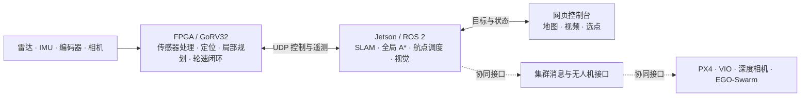

# 基于 FPGA 的机器人实时感知与自主导航

这是一个以高云 FPGA 机器人为主体的工程作品。FPGA 负责实时传感器处理、局部导航与运动控制；Jetson 负责全局建图、路线规划和任务调度；网页展示画面、地图与状态，并支持选择航点。

项目也包含无人机和集群协同接口的源码，用于探索 PX4/MAVROS、VIO、深度相机和 EGO-Swarm 的组合。

## 系统组成



全局目标由 Jetson 在 SLAM 地图中规划并分段调度；支持 `nav_grid_v1` 的 FPGA 在本地栅格中规划和执行短段。网页负责选点、提交和展示，全局 A* 和任务调度在 Jetson 上运行。

| 部分 | 主要内容 |
| --- | --- |
| [FPGA 工程](src/FPGA_ws/) | GW5AT-138C RTL、GoRV32 固件、局部栅格与 A*、传感器、视频和电机控制 |
| [Jetson 工作区](src/ugv_ws/) | UDP/ROS 网桥、slam_toolbox 适配、全局规划、航点调度和视觉任务 |
| [网页控制台](src/website/) | 摄像头画面、地图和设备状态展示，航点选取与提交 |
| [无人机工作区](src/uav_ws/) | PX4 控制、VIO、深度输入与 EGO-Swarm 适配 |
| [集群工作区](src/swarm_ws/) | 机器人间目标、中继与状态消息 |

### 数据与任务流

1. 雷达、IMU、编码器和相机数据进入 FPGA。RTL 完成采集、数据规约、视频传输和轮速控制，GoRV32 固件完成位姿融合、局部建图与导航。
2. FPGA 通过 UDP 向 Jetson 网桥发送遥测和视频。网桥将传感器与里程计数据接入 ROS 2，并向 FPGA 转发控制命令。
3. Jetson 利用激光扫描和里程计构建全局地图，结合最新局部栅格计算路线，将路线切分为短段，逐段交给 FPGA 执行。
4. 网页显示图像、地图、路径和设备状态，并将用户选定的目标提交给 Jetson。任务回执表示命令接收或入队；实际执行、到达和停车状态由设备反馈。

## 核心算法

### 传感器处理与位姿估计

雷达数据在 FPGA 内按 **5° 扇区**规约，每个扇区保留最近的有效回波及其原始角度和时间戳；同一份规约结果供扫描匹配和局部栅格使用。独立的硬件近障检测仍接收原始点，以便及时响应近距离障碍。[雷达规约实现](src/FPGA_ws/boards/BX72_138K_robot/src/navigation/bx72_polar_reduce.sv)

GoRV32 根据编码器轮速和 IMU 角速度预测二维位姿 $(x,y,\theta)$，并维护位姿协方差。以车体坐标系中的速度 $(v_x,v_y)$ 为例，预测步骤为：

$$
\begin{aligned}
x_{k+1} &= x_k + (v_x\cos\theta_k-v_y\sin\theta_k)\Delta t \\
y_{k+1} &= y_k + (v_x\sin\theta_k+v_y\cos\theta_k)\Delta t \\
\theta_{k+1} &= \theta_k + \omega\Delta t
\end{aligned}
$$

位姿历史用于按雷达采样时间插值。扫描匹配采用点到线 ICP，以 Huber 权重降低异常点的影响；匹配结果通过质量和几何条件检查后用于修正位姿。横滚角和俯仰角则由加速度计与陀螺仪进行互补融合。[位姿融合](src/FPGA_ws/boards/BX72_138K_robot/src/firmware/lite/fusion.c) · [扫描匹配](src/FPGA_ws/boards/BX72_138K_robot/src/firmware/lite/csm.c)

### 全局建图与坐标关系

Jetson 将激光扫描和里程计输入 `slam_toolbox`，通过扫描匹配、Ceres 位姿图求解与回环检测生成二维占据栅格。当前配置的地图分辨率为 **0.05 m**；地图保留空闲、占用和未知三种状态。[建图配置](src/ugv_ws/src/car/car_navigation/config/global_slam.yaml) · [扫描处理](src/ugv_ws/src/car/car_navigation/scripts/global_map_core.py)

全局航点保存在 `map` 坐标系。设最新的 `map` 与 `odom` 之间的变换为 $p_{map}=Rp_{odom}+t$，短段下发时使用其逆变换 $p_{odom}=R^T(p_{map}-t)$ 转换到局部里程计坐标系。局部栅格有自己的连续图坐标及其与 `odom` 的对应关系，供 Jetson 叠加局部障碍。回环或位姿修正使原有短段偏离时，调度器取消该段并等待设备状态，再重新规划和下发，避免把新旧坐标直接混用。[全局任务调度](src/ugv_ws/src/car/car_navigation/scripts/global_planner/global_navigation.mjs)

### 分层规划与自主避障

**Jetson 全局规划。** 全局 A* 在 SLAM 栅格上搜索八邻域路径，以 $f(n)=g(n)+h(n)$ 综合已走代价和剩余距离估计；利用欧氏距离变换按车体尺寸膨胀障碍，并叠加 FPGA 的实时局部观测。搜索后对路径线段进行碰撞检查和简化，再按不超过约 **0.75 m** 的短段进行调度。常规半径无路时可以产生较窄通道的候选路线，最终运动仍需通过 FPGA 的车体和制动扫掠检查。地图变化或当前路段受阻时重新评估路线。[全局路径搜索](src/ugv_ws/src/car/car_navigation/scripts/global_planner/global_route.mjs)

**FPGA 局部地图。** 雷达射线更新滚动的 **64 × 64** 栅格，每格 **50 mm**，覆盖约 **3.2 m × 3.2 m**；未观测区域保持未知。局部导航对起点半径 **231 mm** 内的未知格作有限豁免，已知障碍和地图越界仍参与检查。局部地图主要接入雷达前向观测，地图中的未知与空闲有不同含义。[局部栅格](src/FPGA_ws/boards/BX72_138K_robot/src/firmware/lite/local_grid.h)

**FPGA 局部规划。** 固件在局部地图快照的 **32 × 32** 搜索窗口内运行八邻域 A*，使用小顶堆选择搜索节点，并按预算分片执行，避免一次搜索占满控制周期。直行和斜行代价分别为 **10** 和 **14**，未知格另加代价。障碍按车体外形膨胀；搜索可以提供待观察的方向，但不能仅凭路径结果授权通过。搜索结果经过线段检查后作为引导点。[局部路径搜索](src/FPGA_ws/boards/BX72_138K_robot/src/firmware/lite/local_path.c)

**运动预测。** 固件对候选前进和转向速度预测运动与制动过程，检查矩形车体在不同姿态下的扫掠区域、前方观测和轮速约束，再选择可行命令跟踪引导点。独立的近障检测与设备超时机制参与控制，帮助机器人在障碍出现或数据中断时减速和停车。[导航与运动预测](src/FPGA_ws/boards/BX72_138K_robot/src/firmware/lite/navigation.c)

### 底盘控制与视觉

底盘使用麦克纳姆轮运动学，将车体的平移与旋转速度转换为四个轮速目标。FPGA 读取编码器反馈，依据轮速误差及其变化更新各轮驱动量，并输出限幅后的 PWM；控制计算在多个轮子之间复用。[电机控制](src/FPGA_ws/boards/BX72_138K_robot/src/motor/mecanum_motor_control.sv)

OV5647 相机经 CSI-2 输入 **1920 × 1080 RAW10** 图像；FPGA 图像流水线将其处理并缩小为 **640 × 360 YUYV422**，经 DDR 帧缓冲和 RTP/UDP 发送至 Jetson。网桥将图像提供给 ROS 视觉节点，并生成网页使用的图像数据。[图像流水线](src/FPGA_ws/boards/BX72_138K_robot/src/video/camera/gowin_isp/bx72_gowin_isp_pipeline.v) · [Jetson 网桥](src/ugv_ws/src/ugv_bridge/src/ugv_bridge_node.cpp)

Jetson 视觉节点使用 TensorRT 执行目标检测，并通过 ByteTrack 关联连续帧中的目标；任务节点结合检测结果与雷达距离信息，实现目标搜索、接近和跟随等动作。[视觉节点](src/ugv_ws/src/car/car_mission/src/vision_node.cpp) · [任务节点](src/ugv_ws/src/car/car_mission/src/mission_control_node.cpp)

### 无人机与集群接口

无人机工作区将 VIO 位姿和深度相机数据适配到 EGO-Swarm 所需接口，再将规划输出转换为 PX4/MAVROS 控制链路中的位置与航向命令。集群工作区定义目标、中继和状态消息，用于在不同机器人之间传递任务信息。EGO-Swarm 上游源码通过外部获取，项目中的适配与补丁见 [无人机规划接口](src/uav_ws/src/uav_ego_bridge/) 和 [来源说明](src/uav_ws/third_party/README.md)。

## 开始使用

地面机器人需要 FPGA 板卡、对应传感器、Jetson、ROS 2 Humble 和网络连接；完整视觉节点还需要 CUDA、TensorRT、OpenCV 及对应的推理引擎文件。设备 IP、雷达/相机外参和模型路径在 [bringup 配置](src/ugv_ws/src/car/car_bringup/config/bringup.yaml)中按现场设置。

```bash
# 在 Jetson 上构建并启动机器人节点
cd src/ugv_ws
source /opt/ros/humble/setup.bash
colcon build --base-paths src --packages-up-to car_bringup --symlink-install
source install/local_setup.bash
ros2 launch car_bringup car_bringup.launch.py
```

```bash
# 在电脑或 Jetson 上启动网页服务，Node.js 需为 22 或更新版本
cd src/website
npm ci
node server.mjs --jetson 192.168.1.103 --port 6200
```

将示例地址改为实际 Jetson 地址，在运行网页服务的机器上访问 `http://127.0.0.1:8765`。如果 FPGA 重载或会话变化导致坐标域变化，需重新启动全局建图并重新选点；旧地图不会自动与新坐标域拼接。FPGA 构建入口和工具要求见 [FPGA 说明](src/FPGA_ws/README.md)。

## 第三方组件

[ByteTrack](src/ugv_ws/src/thirdparty/bytetrack/README.md) 使用其随附的 MIT 许可。无人机适配保留了 [EGO-Swarm 来源、许可与补丁说明](src/uav_ws/third_party/README.md)；上游规划器需单独获取。FPGA 工程含 Gowin 加密 IP，构建需使用兼容的 Gowin 工具及相应许可。
