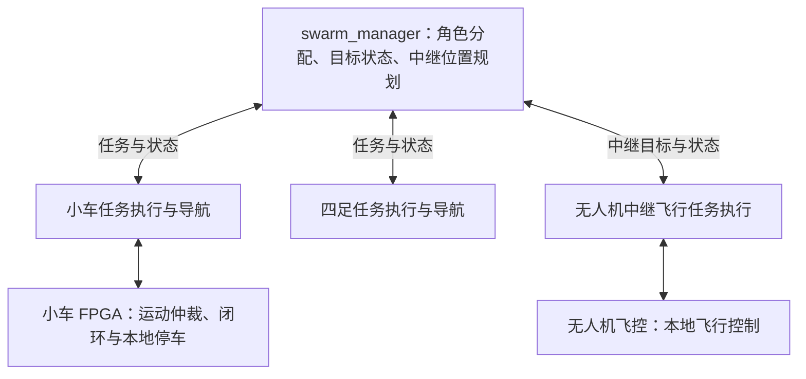
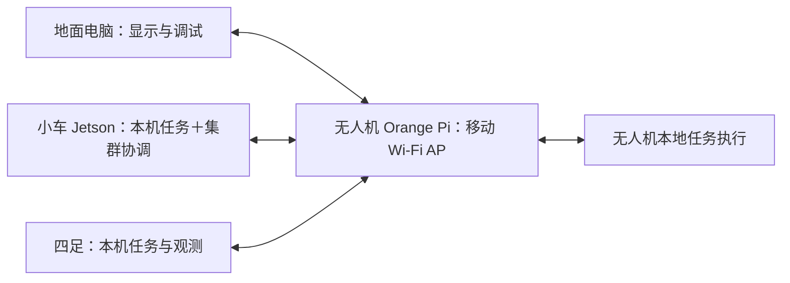

# 室内异构机器人集群方案与三人分工

更新：2026-10-18。本文统一维护总体方案、三人职责、接口边界、交付与验收里程碑，整理本次讨论、用户提供的赛题截图及 GitHub 项目检索结果。建议方案不代表已实现或已通过硬件验证；现有小车工程状态以 [交接文档](handoff.md) 为准。

[返回项目总览](README.md)

[条件与赛题](#1-已确认条件与讨论边界) · [职责与部署](#3-软件职责部署与控制边界) · [共同定位](#4-室内共同定位) · [中继网络](#5-无人机中继网络拓扑) · [三人分工](#8-三人开发分工) · [接口联验](#9-接口负责人和联验边界) · [里程碑](#10-阶段依赖与比赛演示) · [第一轮交付](#11-第一轮具体交付)

## 1. 已确认条件与讨论边界

| 项目 | 当前信息 | 信息性质 |
| --- | --- | --- |
| 运行场地 | 室内，主办方已明确允许无人机飞行 | 用户确认 |
| 集群组成 | 小车、四足机器人、无人机 | 用户确认；数量尚未确定 |
| 集群任务 | 目标跟踪与协同观测 | 用户确认 |
| 无人机补位 | 补通信盲区，恢复地面节点连接 | 用户确认；不是本轮确定的目标观测补位 |
| 小车计算平台 | Jetson Orin Nano 4G，本方案按 4GB 内存理解 | 用户提供；具体系统配置待核对 |
| 无人机计算平台 | 用户描述为 orangepi plus 4g，具有一个 Wi-Fi 模块 | 用户提供；型号、内存、芯片和驱动待核对，不能据此认定有蜂窝 4G 链路 |
| 四足硬件 | 型号、传感器和里程计接口尚未确定 | 用户确认 |
| 外部定位设施 | 不允许或尚未确认 | 用户回答；第一版按不依赖外部设施设计 |
| 工作区 | `FPGA_ws`、`ugv_ws`、`uav_ws`、`swarm_ws` 已存在 | 本地目录核对 |

第一版讨论基线为一辆小车、一台四足、一架无人机。这个数量用于简化验证，不是已经确定的参赛配置。

总体目标：以 FPGA 小车完成核心参赛任务，小车与四足协同观测目标，无人机通过移动中继维持集群通信。各机器人保留本地定位、任务执行和底层控制能力。

## 2. 赛题要求与开发优先级

来源为用户提供的赛题截图，题目为“基于 FPGA 的具身智能机器人实时感知与自主控制系统设计”。截图摘录不替代完整赛事文件。

| 任务 | 截图要求 | 建议实现与验收对象 |
| --- | --- | --- |
| 1. 多传感器感知 | 摄像头采集与显示，IMU 姿态采集与姿态角显示 | 小车 FPGA 采集链、图像与姿态显示；明确显示端与独立运行口径 |
| 2. 运动控制 | 前进、后退、转向、定点旋转，编码器反馈闭环 | FPGA 四轮速度环、运动学与电机驱动；记录目标和实测轮速 |
| 3. 实时避障 | 测距、障碍检测、减速、停车、自主绕障 | FPGA 本地近障约束与任务级绕障；停车与绕障分别验收 |
| 4. 自主导航 | 起终点移动、障碍物避让、路径点导航 | 定位、路径点执行和恢复路线；保存实际轨迹与到点误差 |
| 5. 视觉识别 | 人员、物体识别或指定目标跟随 | 边缘计算视觉处理；检测输出不等于完整任务完成 |
| 6. 智能任务 | 指定目标搜索、语义导航、自主任务执行 | 识别、导航、接近、停车的完整任务链 |

| 评分项目 | 占比 |
| --- | ---: |
| FPGA 实时感知与控制 | 40% |
| 系统稳定性 | 25% |
| 自主导航能力 | 20% |
| 创新设计 | 10% |
| AI 扩展功能 | 5% |

前三项合计 85%，因此先完成小车基础链路和稳定性，再扩展协同观测及中继补位。三类机器人集群是拟采用的创新方案，截图没有要求必须采用集群。

截图的“仅使用 FPGA＋软核 CPU 即可完成”说明基础任务可以用这种组合完成，没有明确写成禁止边缘计算平台参与基础任务。已有项目按 FPGA＋软核独立基础演示的方向规划；本文保留该方向。是否允许 Jetson 承担正式基础导航，以及 Jetson 是否属于允许的“RK3588 等边缘 AI 平台”，仍按完整赛事规则确认。

姿态角显示需单独落实：现有平面 EKF 的航向状态不等于完整 IMU 姿态解算。BX72 已移除 TFT，不能以收到遥测代替显示验收。

## 3. 软件职责、部署与控制边界

### 3.1 工作区职责

| 工作区 | 建议职责 | 当前核对结果 |
| --- | --- | --- |
| `FPGA_ws` | 小车实时采集、轮速闭环、局部融合、本地运动仲裁；独立雷达避障；BX72 当前没有软核 | 双版本雷达 SLAM 已实现，UDP 视频/建图共享 DDR3，回归与两版综合通过；无地图上行协议，PNR及硬件验收见 [交接](handoff.md) |
| `ugv_ws` | 小车与四足的本机接入、定位、导航、视觉、任务执行及集群适配 | `src/car`、`src/legged`、`src/fpga_gateway` 已存在；四足目录目前占位 |
| `uav_ws` | 无人机定位接入、控制、任务状态机和中继位置执行 | 已有相关源码；源码存在不等于实机飞行链通过 |
| `swarm_ws` | 公共接口、目标状态汇总、角色分配、共同坐标管理、链路监测和中继位置规划 | `swarm_interfaces`、`swarm_manager`、`swarm_bringup` 目前占位 |

工作区是源码组织边界，不等于一个工作区只能运行在一台设备上。公共集群接口可部署到各机器人；底盘和飞控专用协议保留在各本机工作区。

### 3.2 第一版部署建议

| 设备 | 建议运行内容 |
| --- | --- |
| 小车 FPGA | 传感器采集、四轮闭环、运动仲裁、本地超时停车及独立雷达避障；实车效果待验收 |
| 小车 Jetson | 小车定位导航、单目标识别跟踪、轻量 `swarm_manager`、坐标对齐与共享状态 |
| 四足机载计算机 | 本机定位导航、目标观测、集群任务执行；依实际平台确定 |
| 无人机 Orange Pi | 本机定位接入与飞行任务执行、Wi-Fi 热点、链路状态上报 |
| 无人机飞控 | 本地飞行控制与飞控状态处理 |
| 地面电脑 | 可视化、记录、调试和人工任务输入 |

Jetson 的 4GB 内存需要通过实际负载测量分配。初版先运行定位导航、单目标识别与轻量状态机，记录内存峰值、处理延迟和温度；完整协同 SLAM 待数据回放和资源评估后再决定部署位置。

### 3.3 控制层级



集群层下发任务、目标位置与约束；本机执行器完成路径、避障和控制。小车运动请求不得绕过 FPGA 仲裁。软核如纳入主线，应实际承担模式管理、路径点或局部绕障状态机，不能只承担打印演示。

无人机定位输入和飞控控制链保留在本机，不通过中继业务网络持续获取飞行所需的关键数据。中继网络失效时，机器人按预先定义的本地任务策略处理；恢复连接后确认新任务，不继续执行积压的旧运动请求。

## 4. 室内共同定位

### 4.1 本机定位与共同定位分别解决什么

本机定位回答“相对本机参考系，我在哪里”；共同定位回答“各机器人、目标和中继候选点在同一场地坐标中在哪里”。为话题或 `frame_id` 改名不能实现共同定位。

| 平台 | 第一版本机定位方向 | 需要验证的内容 |
| --- | --- | --- |
| 小车 | 轮速、IMU、已有局部融合；评估 N10 扫描匹配或地图定位 | 编码器尺度、安装外参、时间、定位漂移与地图输入 |
| 四足 | 优先利用平台提供的可靠里程计；再按相机或雷达配置选择算法 | 可用接口、尺度、漂移、位姿坐标与传感器能力 |
| 无人机 | 现有 VIO 接入方向与飞控本地估计 | 相机/IMU 标定与同步、尺度、坐标约定、重启/重置行为及飞控融合 |

当前 `uav_vio_bridge` 仅保留并转发上游完整位姿，不查找 TF、不执行集群坐标对齐。现有控制源码要求目标位姿使用 `map`；将共同坐标目标接入前，必须明确其到 MAVROS/飞控本地参考系的转换。集群校正不能直接让飞行控制坐标发生未经处理的跳变。

### 4.2 方法比较

| 方法 | 所需条件 | 适用判断 |
| --- | --- | --- |
| 起始姿态对齐＋各自里程计/VIO | 能测量各机器人的起始位置、朝向与高度 | 适合短时初版；只解决初始化，不能持续消除漂移 |
| 各机器人对同一场地地图定位 | 允许并能建立共同地图，各传感器能匹配地图 | 可提供持续约束；共享地图文件或名称不等于都能成功定位 |
| 跨机器人共同观测与回环 | 有足够视野重叠、有效特征和几何匹配 | 用于持续地图对齐；空地视角差异需实测验证 |
| 固定 AprilTag 等视觉标记 | 允许布置标记，已知标记位姿，相机已标定 | 可辅助初始化和漂移校正；场地许可未确认，暂不作为依赖 |
| UWB 基站辅助 | 允许布置基站，设备和几何布局合适 | 可作为位置辅助，朝向和完整飞行定位仍需其他观测；暂不作为依赖 |

建议第一版先做起始姿态对齐与误差测量，再根据场地许可、四足传感器和实测漂移，决定共同地图或跨机器人回环。预先测绘是否允许同样需要确认，不能默认可使用已知地图。

### 4.3 坐标与时间契约

建议共同参考系名为 `swarm_map`，选定地面参考点为原点、场地指定方向为 x 正向、z 向上。各机器人采用独立命名的本地坐标，例如：

```text
swarm_map
├── car_01/odom    → car_01/base_link
├── legged_01/odom → legged_01/base_link
└── uav_01/odom    → uav_01/base_link
```

以上为逻辑关系；实际接入现有 `map`、`base_footprint`、VIO 和 MAVROS 坐标时建立明确映射，每条 TF 只有一个发布者。ROS 命名空间不会自动为所有消息内的 frame 名加前缀。

设 `T_A_B` 表示把 B 系坐标转换到 A 系，则本机位姿的共同表达为：

```text
T_swarm_base = T_swarm_local × T_local_base
```

共同定位模块维护 `T_swarm_local`、质量和更新时间。本机 odom 保持连续；共同参考校正、定位重置与原点变化必须显式处理。无人机需要完整三维变换，不能只沿用小车平面 x/y/yaw。

共享状态至少包含：机器人 ID、位姿、坐标系、估计时间、协方差或质量、数据年龄、启动/定位会话和有效性。视觉观测另保留采集时间；网络接收时间不替代采集时间。

跨设备时间对齐需测量偏差和延迟，不能假设网络连接后时钟自动一致。当前 FPGA 时间映射仍是待验证项。本地超时与运动保护继续使用本地有效时间依据。

### 4.4 协同目标观测

本机检测/跟踪 → 带时间与坐标信息的观测 → 目标关联与融合 → 分配观测位置 → 本机执行。

初版仅跟踪一个指定目标，设主跟踪者和辅助观测者。主跟踪丢失目标或被障碍阻挡后，按可达性、观测质量和通信情况切换角色。

没有深度或有效多视角几何时，共享方向观测，不虚构目标三维位置。机器人自身定位不确定度应进入目标位置判断；不能把同源 FPGA 融合状态与原始轮速/IMU 当成独立信息重复融合。多机器人视野、视角和数据新鲜度共同决定是否适合融合。

## 5. 无人机中继网络拓扑

### 5.1 第一版：单 Wi-Fi 移动接入点

无人机 Orange Pi 提供 Wi-Fi AP，小车 Jetson、四足和协调电脑作为客户端。集群协调运行在 Jetson；电脑用于调试与显示。



AP 转发客户端间通信，调整无人机位置可改变连接条件。这个拓扑没有独立的固定地面 AP 回传链，也不要求初版同时运行 AP＋STA。地面电脑必须能作为客户端接入；客户端隔离、双向业务通信和 ROS 发现需要实测。

只有一个 Wi-Fi 模块不等于支持 AP 模式，也不等于支持 AP＋STA 并发。部署前核对芯片、驱动、接口模式和实际连接能力。

建议采用独立集群子网，例如 `192.168.50.0/24`；这只是待定配置。小车既有 Jetson—FPGA 有线网络与固定端点保持独立，不直接修改当前 `192.168.0.x` 协议配置。

该拓扑把无人机 AP 作为无线通信的关键节点；它掉线时地面机器人仍需保留本机控制与预设断链策略。第一版不承诺自动切换到地面直连。

### 5.2 后续可选：固定 AP＋空中中继

```text
地面协调端/固定 AP ← 无人机回传链 → 无人机接入链 ← 小车、四足
```

采用此方案前，确认单网卡是否支持所需并发模式，以及路由、桥接、发现和重连是否可用；必要时再评估第二个独立无线接口。AP＋STA 并发、同网段透明桥接和端到端业务互通是不同问题，不能仅凭热点能启动认定全部满足。

暂不冻结无线频段、设备采购和无缝切换方案，先测现有硬件。

### 5.3 网络连接与 ROS 数据传输

Wi-Fi AP/路由解决可达性；ROS 2 DDS 或 Zenoh 桥接在已有连接上组织数据。Zenoh 不能恢复物理无线盲区。

初版先验证基础 IP 和实际业务通信，再比较直接 ROS 2 与 Zenoh 桥接。采用桥接时，仅共享任务、位姿、目标观测、链路质量与必要状态；机器人本地高频控制和原始传感器保留在本机。视频、点云按需传输。

如果使用不同 ROS Domain 配合桥接，明确跨域接口、路由与话题过滤，避免直接 DDS 和桥接重复传输。具体版本、配置和启动命令在验证后维护，不照搬其他项目的旧版示例。

## 6. 通信补位与任务协调

建议由 Jetson 上的集群层选择中继候选位置，由无人机本机任务执行器完成移动和保持。

```text
正常服务 → 链路持续变差 → 选择候选位置 → 移动
        → 验证恢复效果 → 保持或调整
```

链路判断使用双向收包、丢包、往返延迟、数据年龄和有效吞吐，RSSI 作为辅助。未经时钟对齐的单向延迟不能直接作为准确指标。

单 AP 模式下，中继位置应兼顾小车、四足及需要在线的电脑；固定 AP 模式还需兼顾回传链。不能简单把地面队形中心或目标位置当成中继最优点。

第一版使用少量可达候选位置和实测链路反馈，增加持续时间判定和滞回，减少反复移动。候选点要满足空间可达性、障碍约束及剩余电量条件；不预设“飞得高一定改善室内通信”。

链路变差时提前规划，避免只能依赖完全断链后的远程指令。完全失联后，无人机按事先下发的有限本地策略保持或恢复到已知可服务位置；具体行为通过本地飞行验收后确定。无人机本机定位失效与业务网络失效分别处理。

建议的公共接口对象：

| 对象 | 主要信息 |
| --- | --- |
| RobotState | ID、能力、位姿、时间、质量、电量、任务状态、定位会话 |
| TargetObservation | 观测者、目标关联信息、采集时间、坐标、方向/位置、质量与不确定度 |
| LinkState | 端点、测量窗口、收包/丢包、RTT、数据年龄、吞吐、可选 RSSI |
| TaskAssignment | 任务 ID、角色、目标、坐标系、约束、有效期与版本 |
| TaskStatus | 接受/执行/结束状态、失败或拒绝原因 |
| RelayGoal | 服务节点集合、中继候选位置、坐标、有效期与到达条件 |

以上为设计对象，不是已冻结的 ROS 消息定义。失联状态不能当成有效零值；任务恢复后使用新鲜状态重新确认执行。

## 7. GitHub 开源与公开代码参考

检索日期：2026-10-07。已查看项目说明、依赖和部分源码，没有在本机执行安装、编译、数据集回放或飞行验证。本次没有找到完全符合三类机器人、室内、单 Wi-Fi 动态中继配置的完整系统。

| 项目 | 能力与借鉴点 | 适配限制与建议 |
| --- | --- | --- |
| [Swarm-SLAM](https://github.com/MISTLab/Swarm-SLAM) | ROS 2 多机器人协同 SLAM，支持 LiDAR、双目和 RGB-D；跨机器人回环优先级与通信组织 | 共同定位优先研究对象；官方启动文档采用 Foxy，Humble、传感器和资源需验证 |
| [Swarm-SLAM 实验配置](https://github.com/lajoiepy/cslam_experiments) | 真实设备、数据集、launch/config 和 Zenoh 桥接示例 | 用于接口和实验组织参考；不能据示例认定现有 N10/相机可直接接入 |
| [GBPlanner / OmniPlanner](https://github.com/ntnu-arl/gbplanner_ros) | 探索、巡检与目标点规划；有四足和无人机协作背景 | 参考机器人能力与规划控制边界；当前默认分支为 GBPlanner 3，安装仍采用 Noetic；历史 `gbplanner2` 另见仓库说明 |
| [UAVros](https://github.com/shupx/UAVros) | PX4/Gazebo 空地编队、视觉跟踪与协同搜索示例 | ROS 1；部分例子依赖 AR 标记或 GPS。借鉴任务接口和仿真组织，不直接照搬室内定位或飞控参数 |
| [GAC-Mapping](https://github.com/SYSU-RoboticsLab/GAC-Mapping) | 空地异构多会话建图、数据关联与位姿图优化 | 城市场景、ROS Melodic、Visual-LiDAR 和同步要求；先做离线方法研究 |
| [D²SLAM](https://github.com/HKUST-Aerial-Robotics/D2SLAM) | 无人机集群分布式视觉惯性 SLAM、相对位姿与一致轨迹 | 当前前端依赖 CUDA，文档包含 Xavier NX 验证；不作为 Orange Pi 初版部署方案。Jetson 4GB 上也需独立评估 |
| [Zenoh ROS 2 Bridge](https://github.com/eclipse-zenoh/zenoh-plugin-ros2dds) | 桥接 ROS 2 话题、服务和 Action，命名空间与紧凑发现信息交换 | 跨机器人数据传输优先评估对象；不承担无线射频中继或位置规划 |
| [linux-wifi-hotspot](https://github.com/lakinduakash/linux-wifi-hotspot) | Linux 热点与命令行配置，部分网卡 AP＋STA 并发 | 参考移动热点配置；硬件/驱动是否支持要在 Orange Pi 核验 |
| [Indoor Exploration Competition](https://github.com/BYU-FROST-Lab/indoor-exploration-competition) | 室内探索、墙体衰减通信模型、信息回传与交接仿真 | 可参考通信图与策略测试；默认 relay 包含携带数据返基站，不等于连续无线中继 |

优先顺序：移动热点与通信验证 → Swarm-SLAM 数据回放和坐标对齐 → 参考 UAVros/GBPlanner 组织任务接口。无需第一版同时引入所有项目。

参考定位实现时，要求足够的共同观测及有效几何约束；空地视角差异不能只靠软件接口消除。Wi-Fi 中继与协同 SLAM 带宽预算需一起测量。

实际引入源码前核对所选提交及各依赖许可。检索中总仓库标注 Swarm-SLAM 为 MIT、GBPlanner/UAVros 为 BSD-3-Clause、GAC-Mapping 为 GPL-3.0、linux-wifi-hotspot 为 BSD-2-Clause；其他候选及组件许可未在本文完成逐项审查。公开可读源码不自动意味着复制、修改和分发许可已经明确。

## 8. 三人开发分工

A/B/C 为职责占位，实际姓名待团队对应；以下任务是计划，不表示已实现或验收通过。

### 8.1 分工总表

| 人员 | 主责 | 主要工作区 | 首要交付 |
| --- | --- | --- | --- |
| A：FPGA、软核与小车底层 | 感知采集、闭环控制、本地保护、软核基础任务及底层接口 | `FPGA_ws`；板级协议文档 | 可核对身份的小车候选、感知显示输入、闭环运动与停车证据 |
| B：无人机与无线中继 | Orange Pi、飞控、无人机本地定位接入、移动热点、链路监测、中继位置策略 | `uav_ws`；`swarm_ws` 内独立中继策略部分 | 三端无线互通、本地无人机控制链、可测量的补位效果 |
| C：地面软件、共同定位与集群 | Jetson 接入、地面定位导航、视觉、四足适配、公共接口、任务与坐标管理、集成记录 | `ugv_ws`；`swarm_ws` 公共接口与管理入口 | ROS 控车和地面状态、共同坐标、主/辅观测与集群任务闭环 |

与已有小车验收分工衔接：A 继续负责 FPGA/底层通信，B 在首轮继续安排物理标定和小车硬件操作，C 继续负责 Jetson/ROS 与日志。小车基础验收后，B 的主要开发转到无人机与无线中继；小车底层问题由 A 主责，B 按试验需要配合。

C 的范围较广，第一版限于单目标、简单角色规则和起始坐标对齐。完整协同 SLAM、复杂多目标关联和无缝网络切换不作为首轮必交付。B 独立承担中继候选位置策略，避免无线、飞行和策略集成都集中到 C。

### 8.2 A：FPGA、软核与小车底层

#### 8.2.1 现在开始

1. 核对当前源码、位流、清单和板上身份，先解决已有交接中的候选交付缺口。
2. 延续已确认的轮位/极性，完成整圈计数、轮径和底盘几何参数的物理核验；由 B 配合记录动作，C 同步采集日志。
3. 完成当前候选悬空运动、视频/遥测并发、命令断流停车和恢复验收，再进入低速落地。
4. 明确提供给 C 的车体速度请求、回执、轮速、IMU、N10、融合状态和健康信息；保持已冻结协议兼容。

#### 8.2.2 后续实现

- 近障测距有效性、减速和停车约束，覆盖实际开放的运动方向；麦轮横移和旋转需对应观测覆盖及车体外形判断。
- IMU 姿态解算和可显示数据。现有平面 EKF 的 yaw 不能替代完整姿态显示。
- 软核模式管理、路径点和局部绕障基础状态机；其速度请求经过与上位机一致的硬件仲裁。
- 轮式/IMU 局部定位的尺度、时间与质量输出；已有 EKF 优先标定和验证，避免重复实现。
- 按赛事解释维护 FPGA＋软核独立基础任务演示，以及与 Jetson 协同的扩展演示。

#### 8.2.3 交付与完成条件

| 交付物 | 完成条件 |
| --- | --- |
| 源码/位流/部署清单 | 实际哈希与板上身份可对应本轮候选 |
| 标定参数及控制记录 | 目标/实际轮速、方向、计数尺度和动作均有实测依据 |
| 本地停车与恢复记录 | 断流/断链触发、输出停止和物理停转分别记录；恢复不执行缓存旧速度 |
| 感知及姿态显示输入 | 图像与姿态可显示，时间、单位和有效性清楚；显示端由 A/C 联验 |
| 近障及软核任务演示 | 减速停车、绕障、路径点分别给出动作证据和通过/失败记录 |

### 8.3 B：无人机与无线中继

#### 8.3.1 现在开始

1. 核对 Orange Pi 准确型号、操作系统、相机/IMU接口、Wi-Fi 芯片、驱动及 AP 能力；用户的“4g”不自动解释为蜂窝链路。
2. 不飞行先建立移动热点台架，小车 Jetson、四足设备或临时代替的电脑作为客户端，验证客户端间双向通信。
3. 保存链路收包/丢包、RTT、数据年龄和可选 RSSI；C 配合验证实际 ROS 或桥接业务数据。
4. 核对现有 `uav_control`、`uav_mission`、`uav_vio_bridge` 的运行边界，逐步完成本机定位、飞控接入与任务执行。

四足硬件尚未确定时，可用电脑验证网络和接口流程，但记录中必须标明替代节点，不计作四足实机验收。

#### 8.3.2 后续实现

- Orange Pi 提供单 Wi-Fi AP；需要固定 AP 回传时，先核验 AP＋STA 并发、转发与业务发现，再决定是否增加无线接口。
- 无人机位姿、坐标、估计时间、质量、电量和飞行任务状态上报。
- 配合 C 标定无人机本地坐标到 `swarm_map` 的关系；B 实现本机目标转换，避免集群校正直接跳变飞行控制参考。
- 中继策略：服务节点选择、可达候选点、链路持续变差判定、滞回、位置保持及小幅调整。
- 将集群 `RelayGoal` 转为本机任务，返回接受、执行、拒绝与结束状态。
- 本机处理业务失联与定位失效；飞行关键控制和定位链保留本机，断链不依赖新远程命令才能处理。

中继策略可位于 `swarm_ws`，运行在小车 Jetson 上；B 负责算法与独立实现，C 负责管理器调用和任务仲裁。双方先约定模块接口，不同时改同一管理入口。此处仅规划归属，尚不创建新功能包。

#### 8.3.3 交付与完成条件

| 交付物 | 完成条件 |
| --- | --- |
| 无线与 Orange Pi 配置清单 | AP 能力经过实际连接验证；配置可重复启动 |
| 网络台架记录 | 三端双向业务互通，连接失败和恢复行为有日志 |
| 本地定位/飞行记录 | 位姿轴向、尺度、时间、质量和任务执行逐项核对；仿真与实机结果分开 |
| 中继策略及任务适配 | 输入节点状态和链路状态，输出可达目标；过期/不可达任务有明确结果 |
| 补位对比记录 | 相同场景下比较直连、固定位置 AP 与移动 AP，记录有效数据更新、丢包、RTT 和恢复时间 |

### 8.4 C：地面软件、共同定位与集群

#### 8.4.1 现在开始

1. 核对 Jetson Orin Nano 4GB 的系统、ROS 2 Humble 与现有 C++ 包构建；确认 UDP 端口占用和运行入口。
2. 与 A 完成 ROS `/cmd_vel` 到现有三轴协议的适配，保证控制来源唯一、新鲜度与停车行为一致。
3. 配合 A/B 同步保存视频、遥测、请求、回执和实际动作，区分接收时间与采集时间。
4. 调查四足 SDK、里程计、传感器和机载计算接口，给出可接入性清单；不在平台未定前编写厂商专用控制实现。
5. 主责公共集群接口初版，先明确坐标、单位、时间、会话、有效性和任务回执。

#### 8.4.2 后续实现

- 小车本机定位、唯一 TF 发布者、路径点导航；避免同源测量重复融合。
- 四足本机接口适配与任务执行，底层步态控制优先复用平台能力。
- 单目标视觉检测/跟踪与观测输出，区分方向观测和有几何依据的位置观测。
- `swarm_map` 与各机器人本地参考系的初始化、质量管理和重置处理；先起始姿态对齐，再评估持续校正。
- `swarm_manager` 主入口：状态汇总、主/辅观测角色、任务分配、回执和重连后任务确认。
- 调用 B 的中继策略并仲裁任务；B 提供候选位置和约束，C 不重复实现无线补位算法。
- 网络业务层集成：先验证直接 ROS 2 通信，再按需求评估 Zenoh 桥接、命名空间和话题过滤。
- 集成启动、可视化、日志及可重复场景；测量 Jetson 内存、延迟和温度后再扩展完整协同 SLAM。

#### 8.4.3 交付与完成条件

| 交付物 | 完成条件 |
| --- | --- |
| Jetson 构建与启动入口 | 实际构建、跨进程发布订阅及 UDP 联调记录齐全 |
| ROS 控车与状态 | 有效请求正确转发，过期与断流停车、控制来源切换可验证 |
| 地面定位/导航 | 位姿尺度、坐标、时间和质量明确；到点误差与重复动作有实测 |
| 公共接口与共同坐标 | 三方认可消息语义；两机器人轨迹可对齐，重启/重置不会被当成连续有效位姿 |
| 单目标协同任务 | 主/辅观测、丢失后接替、取消与恢复过程可回放 |
| 综合配置与记录 | 启动版本、实际参数、资源用量、成功和失败记录可重复核对 |

## 9. 接口负责人和联验边界

| 接口/事项 | 主责 | 配合/复核 | 首版必须明确 |
| --- | --- | --- | --- |
| FPGA—Jetson 有线协议 | A | C | 线格式、单位、时间、来源、会话、序号、有效期、回执与停车 |
| ROS 控车/接收节点 | C | A | 本地协议适配、唯一来源、端口独占及断流行为 |
| 小车标定与现场动作 | A | B 操作配合、C 记录 | 当前候选身份、计数尺度、外参、负载响应与停止表现 |
| 无线 AP 与链路探测 | B | C | 双向互通、客户端隔离、RTT/丢包窗口与重连 |
| ROS/Zenoh 跨机数据 | C | B | Domain/命名空间、共享范围、QoS、重复路由与数据年龄 |
| 公共 `swarm_interfaces` | C | A/B 审阅 | RobotState、TargetObservation、LinkState、TaskAssignment、TaskStatus、RelayGoal |
| 共同坐标与跨机时间 | C | A 提供 FPGA 时间语义、B 提供无人机坐标/时间 | 变换方向、轴向、尺度、质量、时间映射与会话重置 |
| 无人机目标转换与执行 | B | C | `swarm_map` 到本机控制参考，任务新鲜度、可达性与回执 |
| 中继位置策略 | B | C | 服务节点、候选点、质量反馈、滞回及退出条件 |
| 集群角色与任务管理 | C | B 中继策略、A 小车执行能力 | 主/辅观测、冲突仲裁、失联及恢复后的任务确认 |
| 比赛基础部署口径 | A | B/C | FPGA＋软核独立演示、Jetson 扩展范围及显示端 |

公共接口按最小可用字段先落地；新增字段同步更新说明和样例。各负责人维护自己主责部分，跨工作区变更先给出接口影响。无线网络与 FPGA 有线网络独立配置，不为了集群直接修改已冻结板级协议。

## 10. 阶段、依赖与比赛演示

没有比赛截止日期和人员可投入时间，本文使用交付里程碑，不虚构周数或完成日期。各阶段保存实际版本、配置、输入输出、原始日志、真实动作及通过/失败记录。

| 里程碑 | A | B | C | 完成证据与进入下一阶段的条件 |
| --- | --- | --- | --- | --- |
| M0：条件与接口 | 核对候选与已有板级接口 | 核对无人机/Wi-Fi；协助小车物理测量 | 核对 Jetson/四足接口；公共契约初版 | 设备与接口清单、输入输出样例、职责和未知项形成记录 |
| M1：基础链与网络台架 | 悬空/低速闭环、停车与传感器核对 | 单 AP 双向通信、网络测量；独立飞行链调试 | 构建、采集/显示与 ROS 控车适配 | 小车控制/姿态显示有证据；网络台架双向业务互通；记录轮速、计数、停止表现和链路质量 |
| M2：本机定位与基础任务 | 近障约束、软核路径点/绕障、局部定位标定 | 无人机本机定位/任务；冻结 RelayGoal 执行语义 | 地面定位导航、单目标观测 | 位姿质量、时间和漂移可信；路径点/绕障有动作、到点误差和失败记录；飞行与仿真结果分开 |
| M3：共同坐标与地面协同 | 提供稳定执行与故障状态 | 无人机坐标/时间配合；独立中继策略及链路反馈 | 起始对齐、主/辅观测、角色切换和任务管理 | 两机器人轨迹对齐及误差可测，目标关联与接替可重复；替代节点只算接口验证 |
| M4：动态中继 | 维持断链下本地保护 | 执行补位并比较直连、固定/移动 AP | 集群仲裁、目标转换集成与同时间段日志 | 本地飞行链与共同目标转换已验收；记录丢包、RTT、有效更新、恢复时间和飞行状态，补位收益可测 |
| M5：比赛综合演示 | 基础任务与 FPGA 证据 | 飞行/中继与现场配置 | 集成启动、可视化、协同任务与资源记录 | 核心与集群任务均有重复成功/失败记录；配置和日志能支持复现，资源及长时运行表现可核对 |

依赖顺序：小车物理标定/停车 → ROS 实车控车 → 定位与导航；本机定位可信 → 共同坐标 → 协同观测；无线台架＋本地飞行验收＋共同目标转换 → 动态补位。无线台架与无人机独立调试无需等待小车导航。

三人可同时推进各自不依赖硬件动作的工作。小车运动试验由首轮 B 统一安排，A 负责程序和放行记录，C 负责日志；无人机飞行由 B 统一安排。现场同一台机器人只设一个操作入口，集成记录中标明当前操作者。

比赛演示分两段：先证明 FPGA 小车核心任务，再展示小车与四足协同观测、无人机移动恢复通信。地面直连、固定位置 AP 与移动 AP 的效果分别记录，避免把普通连接成功当成动态补位收益。

所有性能阈值根据场地、机器人速度、目标运动和实测结果确定。本文不承诺尚未量测的厘米级精度、恢复时间、覆盖范围或成功率。

## 11. 第一轮具体交付

| 人员 | 第一轮必须交付 | 可同步推进 |
| --- | --- | --- |
| A | 当前候选及缺口清单；已有有线协议样例；小车标定/停车验收步骤与实际结果 | 近障输入及软核任务接口定义 |
| B | Orange Pi/Wi-Fi/飞控清单；单 AP 台架配置与双向业务测量；小车物理测量记录 | 无人机本机定位接入核对，中继候选位置策略草案 |
| C | Jetson 构建与运行核对；ROS 控车适配方案；四足接口调查；公共接口字段样例 | 日志工具、两机器人状态模拟和共同坐标回放 |

第一轮合并一份联调记录：实际版本、测试条件、输入/输出样例、通过/失败和阻塞项。依次处理有证据的接口问题；完成当前验证条件后进入下一里程碑，不以代码存在或收到回执代替实机任务完成。

## 12. 范围收敛与证据维护

先完成一个目标、三节点网络、有限中继候选点和起始坐标对齐。完整 Swarm-SLAM 由 C 评估，B 配合无人机数据；其他开源规划/视觉方法按需要借鉴，不同时引入全部依赖。

各主责人员提交对应源码、配置、实验记录和文档。共享文档保存于 `docs/`，板级接线、固件和测试细节随所属工程维护。C 汇总综合记录，A/B 复核自己的接口与实测结论。实际验收阈值由测试条件和测量结果确定。

待人员能力与可投入时间明确后，可调整具体任务，但每个接口保留唯一主责，当前候选验收职责与调整后的集群职责需明确交接。

## 13. 待收敛事项

1. 完整赛事文件对基础任务独立部署、显示位置、预先测绘和 Jetson 平台的限制。
2. 场地尺寸、布局、遮挡、天花板高度、照明以及目标类型和运动方式。
3. 四足型号、SDK、可用传感器、里程计接口和机载计算平台。
4. Orange Pi 准确型号、系统、相机/IMU配置、Wi-Fi 芯片与 AP 能力。
5. Jetson 4GB 的实际软件负载及本机任务与集群协调资源预算。
6. 本机定位误差、共同坐标初始化和持续校正方法。
7. 单 AP 是否满足场景；是否需要固定 AP 回传、第二无线接口或后续切换能力。
8. 中继失效、定位失效、任务取消与重新连接时的具体本地执行行为。

以上事项逐项通过数据和接口验证收敛，保持研究原型实现简单、可调试。
