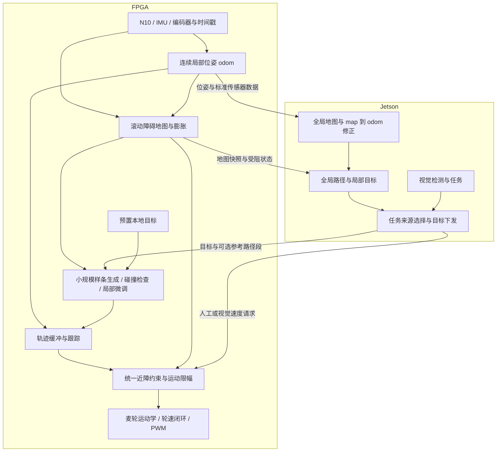

# 小车软硬件协同规划架构草案

日期：2026-10-24。状态：重新设计方案；尚未实现新架构、生成新位流或完成实车验收。

用户允许推倒现有架构重新规划。本草案先沿用 BX72 / GW5AT-138C、Jetson Orin Nano、四轮麦轮、N10、IMU660RC、编码器和 OV5647，不以购买新硬件作为前提。重新划分软件、RTL、通信和存储职责；现有实现作为可复用模块与对照基线，不作为必须保留的架构约束。

## 0. 整机功能与协作总览

本总览描述重构后的完整目标系统。“已有基础”只表示当前源码具备对应模块，不表示当前最终源码已经通过全部实板验收；“新增/扩展”需要后续实现。首版服务于二维平面环境中的麦轮小车。

### 0.1 FPGA功能

| 功能域 | 目标内容 | 当前基础与新增边界 |
| --- | --- | --- |
| 传感器采集 | N10串口解析、角度/距离/强度与成帧检查，IMU SPI原始数据，四轮编码器与非法跳变统计 | 驱动基础已有，统一数据提交与新接口需整理 |
| 时间与跨域 | 原始时间戳、序号、新鲜度、整帧FIFO/快照、时钟复位 | 基础已有，64位对外时间与新任务跨域需扩展 |
| 里程计与局部定位 | 麦轮运动学、连续odom、局部扫描匹配、平面EKF及陀螺偏置估计 | CSM/EKF基础已有，滚动匹配参考和连续运行需扩展验证；不声称已有完整三维姿态解算 |
| 打滑与退化处理 | 轮速/雷达/IMU一致性、观测有效性、动态观测权重和诊断 | 基础已有，噪声与机械参数需标定 |
| 局部障碍地图 | 128×128滚动栅格、位姿投影、射线清障、未知/占据状态、障碍膨胀及快照版本 | 新增，不能把现有定位子图直接当导航障碍图 |
| 轻量局部规划 | 少量二维B样条初值、样条采样、碰撞驱动坐标微调、成本评价与硬约束检查 | 新增，不移植原版EGO/L-BFGS |
| 轨迹执行 | 轨迹双缓冲、状态连续交接、短段执行、滚动重规划、到点/受阻判断 | 新增，输出车体vx/vy/wz进入统一运动入口 |
| 运动仲裁 | 独立任务、协同导航、人工/视觉速度的显式来源切换 | 现有手动/VFH仲裁需重构；未选来源不能覆盖当前任务 |
| 近障与故障处理 | 所有来源经过近障、各轮约束、任务有效期、传感器/定位失效和超时处理 | 限幅与超时基础已有，统一近障约束需新增 |
| 电机闭环 | 四轮速度反馈、目标变化限制、方向、PWM、制动与零速流程 | 基础已有；先按现有50 Hz速度环、20 kHz PWM集成，机械验收另做 |
| 相机与ISP | OV5647配置、CSI-2 RAW10接收、CFA、缩小/ROI、持续AWB、保边降噪、中性CCM、Gamma、YUYV输出 | candidate23代码与离线证据已有，整链稳定性及新候选实板验证仍待完成 |
| 存储 | 视频DDR3双缓冲、坏帧拒绝、FIFO与背压；地图/规划工作集放片上RAM | 视频基础已有，规划RAM新增；只实例化一套DDR控制器 |
| 通信与诊断 | RGMII/PHY、UDP控制与回执、RTP视频、传感器遥测、序号/错误/丢弃计数 | 基础已有，目标任务、地图及规划状态协议需扩展；ACK只表示相应软件/硬件接收阶段 |

### 0.2 Jetson功能

| 功能域 | 目标内容 | 当前基础与新增边界 |
| --- | --- | --- |
| FPGA接入 | UDP收发、视频组帧/颜色转换、遥测解码、任务与回执管理 | 最新ugv_bridge已有视频/遥测/速度控制基础，新任务协议需新增 |
| ROS适配 | 完整LaserScan、轮式里程计/融合位姿、TF、源时标映射、相机图像与标定信息 | 图像/原始遥测基础已有，完整扫描、里程计和TF需补齐 |
| 全局建图与定位 | 全局SLAM、回环、全局地图保存/加载、map→odom | 新导航链需接通和验证，不能用现有原始雷达显示代替 |
| 全局路线 | 长距离选路、局部目标/参考路径段生成、受阻时改道、全局到点判断 | 新增；不与FPGA同时运行两个拥有运动控制权的局部控制器 |
| 视觉识别与跟踪 | 图像预处理、TensorRT检测、ByteTrack、选定目标及丢失处理 | 最新源码已有相关节点，engine兼容与真实效果待验证 |
| 视觉任务 | 图像空间转向、目标状态与任务切换；有可靠测距/坐标后才能生成目标位置 | 当前默认仅转向，不能把框大小冒充距离或宣称已有定距跟随 |
| 控制与任务管理 | 选择人工/视觉/导航来源、开始/停止/取消任务、软件急停、授权和进度反馈 | 现有任务/授权可复用，新增局部目标任务需接入 |
| 网页与调试 | 向PC服务转发图像、状态与操作，记录回放、性能统计、机械与传感器标定工具 | 基础已有并需随新架构适配；PC只作交互/调试，不承担实时闭环 |

### 0.3 两端交换的数据与执行流程

硬件连接保持：传感器、电机和相机直接接FPGA；FPGA与Jetson通过有线以太网交互；PC通过Jetson访问控制台。

| 方向 | 数据 | 用途 |
| --- | --- | --- |
| FPGA→Jetson | 雷达原始点/完整扫描所需数据、IMU、编码器、轮式及融合位姿、源时间戳 | ROS适配、全局SLAM和记录；按算法区分原始轮式与已融合雷达的位姿，避免重复融合 |
| FPGA→Jetson | 视频、任务进度、选中轨迹摘要、地图快照、受阻/故障与资源统计 | 视觉、显示、路线恢复和调试 |
| Jetson→FPGA | 局部目标、可选参考路径段、任务编号、odom连续域编号、限速、到点容差、有效期和模式 | FPGA自主生成并执行局部轨迹，不逐次请求成本/梯度 |
| Jetson→FPGA | 人工/视觉速度请求、停止/取消/急停、参数和时间映射信息 | 显式模式内的控制与配置；参数更新不应破坏正在执行任务的一致性 |

协同导航流程：Jetson接到最终目标→全局地图中选路→变换并下发局部目标→FPGA更新局部地图并生成/微调轨迹→FPGA跟踪、避障和轮速闭环→上报局部到点/受阻→Jetson推进目标或重新选路。

FPGA独立流程：预置或一次下发合法本地任务→本机采集/定位/建图→本机规划/执行→到点、任务超时或受阻后停车。独立模式可不依赖Jetson心跳，但仍需传感器、定位和本地任务有效；人工/视觉模式仍在请求过期后停车。

两端协作不是两个平级控制器同时给电机发命令。Jetson决定全局目标及任务，FPGA是最终运动执行入口；本地失效或不满足近障/运动约束时可以拒绝执行。

## 1. 主要决定

1. Jetson 负责全局建图与定位修正、全局路径、局部目标/参考路径段、视觉与任务。
2. FPGA 负责传感器时间基准、连续局部位姿、滚动障碍地图、小规模B样条轨迹生成与局部微调、轨迹检查与跟踪、麦轮闭环和统一运动约束。
3. 一次局部规划在 FPGA 内完成；正常局部避障不等待 Jetson 提供控制点初值、梯度或障碍回弹约束。
4. 首版借鉴EGO的少量控制点、平滑轨迹、碰撞驱动调整和滚动重规划，采用约10个二维三次B样条控制点、最多3条初值及固定轮数的坐标搜索。初值生成、轨迹微调和执行共用一条样条评价链，软件EGO仅作开发对照。首版不是原版EGO的等价移植。
5. 视频使用 DDR3；规划工作集优先放片上 RAM。第一版不恢复历史 DDR 全局建图或复制第二套 DDR 控制器。
6. 视觉、导航和人工控制先选唯一请求来源，所有来源都经过 FPGA 的近障约束、运动限幅及超时处理，最后进入同一电机控制入口。

首版的计算链采用纯RTL与片上RAM，不要求新增软核、L-BFGS、浮点IP、全局ESDF或局部A*。平滑轨迹评价与碰撞检查共用缓存及少量时分复用乘加单元；不同时部署一套大规模速度候选规划器和另一套样条优化器。

独立运行的定义是：预置或一次下发本地目标后，FPGA能靠本机传感器完成局部建图、绕障与执行。它不保证绕出U形障碍、死胡同或完成跨房间全局导航。Jetson断开后能否继续，由任务模式与有效期决定，不能统一认定继续或统一删除看门狗。

## 2. 当前证据与新目标的区别

| 范围 | 当前核对结果 | 新架构要求 |
| --- | --- | --- |
| FPGA | 本地 bx72-gowin-isp 的 candidate23，纯 RTL；视频独占 DDR3；CSM/EKF、打滑和 VFH 保留 | 增加本地规划、地图与轨迹执行，重新验证整板 |
| candidate23 | 构建门禁通过，最差 setup +0.067 ns；未下载该候选 | 不继承为新架构时序或功能通过 |
| ROS | 远端 ugv_ws@13dc1425a7e57a994e1e1d3434f57e69cb43b436 已有 /cmd_vel 授权入口、PT97 视频和视觉任务；提交声明构建/测试/硬件待验证 | 增加标准扫描、里程计、TF、地图与规划任务接口 |
| 本地 ugv_ws | 仍停在 4dc80da，存在未提交文档修改 | 后续实施先对齐版本并保留本地修改 |
| 定位 | 现有 CSM 为固定局部子图，不能据此认定具备持续大范围导航 | 建立可更新的局部匹配参考与连续 odom；Jetson 管理全局修正 |
| 控制 | 当前 FPGA 自动模式选择 VFH；ROS 速度不自动叠加 VFH 避障 | 改为统一的请求来源选择与独立近障约束 |

旧顶层文档中的蓝牙、DDR 地图共享和旧 ROS 启动入口属于历史，不作为新设计输入。文档记录的 Jetson 为 Orin Nano 4G，实际内存、功耗模式与软件环境在部署前重新核对。

## 3. 数据流与所有权

- FPGA 是 odom 连续位姿和局部规划地图的唯一提交方；Jetson 获取带版本的镜像用于路径引导、显示与受阻处理。全局建图同时需要完整扫描、外参和时间，不只依赖小窗口地图拼接。
- Jetson 是全局 map 的维护方；回环与全局定位修正通过 map→odom 表达，不直接跳变 FPGA 的局部里程计或执行中的轨迹。
- 视觉当前只有图像空间目标与转向能力；没有可靠深度、外参和目标定位时，不把检测框中心或框大小当成地图目标坐标。
- ROS /cmd_vel 作为人工/视觉速度请求入口继续可用；自主导航主要下发目标与可选参考路径段，FPGA自行产生局部运动。不能同时让多个节点向最终控制入口竞争。

### 3.1 运行模式与控制权

| 模式 | Jetson输入 | FPGA职责 | Jetson断开后的行为 |
| --- | --- | --- | --- |
| 人工/视觉速度 | 有有效期的车体速度请求 | 近障约束、限幅与闭环 | 请求过期后停车 |
| 协同导航 | odom坐标目标、参考路径段、速度上限、有效期 | 本地建图与绕障、跟踪、受阻上报 | 仅在任务明确许可的期限内继续，否则停车 |
| 独立本地任务 | 可预置，也可启动前一次下发 | 自行生成轨迹、局部避障、到点判断与停车 | 不依赖网络心跳；仍受任务时限、传感器与定位有效性约束 |

紧急停止和本地故障处理覆盖所有模式；人工接管需显式切换来源。导航与视觉控制互斥，未被选中的来源不能用零速心跳覆盖正在执行的任务。地图/定位失效或没有合格轨迹时停车并保持明确状态，不盲目脱困。

### 3.2 两种地图与坐标关系

- Jetson维护全局map、全局路线和map→odom；FPGA维护连续odom与odom→base_link。
- 雷达与IMU安装外参固定标定，数据保留FPGA源时标；Jetson将全局目标转为带odom连续域编号的局部目标下发。
- 回环引起map→odom变化时，Jetson重新生成局部目标/路径段；不直接跳变FPGA局部位姿。odom重置或坐标域编号变化时旧任务失效。
- FPGA定位匹配参考与障碍地图分开；Jetson全局地图用于远距离选路，FPGA滚动地图用于新鲜障碍与运动约束。

## 4. FPGA 的计算与存储划分

### 4.1 传感器与局部定位

保留可复用的传感器驱动、编码器解码、麦轮运动学和融合数学模块，重新整理提交时间、坐标系、有效标志及跨域接口。已有输入时间戳是读取/解析提交时刻，不冒充传感器内部采样时刻。

为局部匹配增加滚动参考或有限关键帧更新机制，明确参考切换时的坐标变换；现有固定 CSM 子图只作基线。FPGA EKF 维持连续 odom，Jetson 使用扫描与必要的轮式里程计信息建立全局图；不能把同一激光信息通过两个滤波器重复当成独立观测融合。

先保留现有 50 Hz 电机控制周期作为集成起点，是否提高频率由编码器计数质量、机械响应和资源测量决定。

### 4.2 滚动障碍地图

原型容量目标：128×128、64 mm/格，覆盖 8.192×8.192 m；原点在 odom 中，按整数网格移动。规划视野最终取决于雷达可用范围、外参和环境，不由 RAM 尺寸证明。

每格基础状态使用 2 bit，区分未知、空闲、占据与保留状态；另有 1 bit 膨胀结果。两份快照的基础数据容量为 12 KiB，未包含证据计数、时间记录、接口 FIFO 和 RAM 端口复制。实际 BSRAM 消耗以综合结果为准。

地图更新必须包括有效扫描组帧、位姿对齐、必要的运动补偿、射线空闲更新、命中更新、窗口移动、陈旧障碍处理及未知区处理。未知区域不能无条件当成可通行。

规划使用固定快照。双缓冲在快照仍被使用时不得覆盖；若没有空闲缓冲，可暂缓发布或结束旧任务，不能写入正在读取的银行。银行切换后清理或同步旧银行，避免隔帧旧状态重新出现。任务结束时在最新可用地图上复查；地图更新频率不足以覆盖运动风险时，按新鲜度规则减速或停车。

定位匹配地图与规划障碍地图分开维护，二者的空闲、未知、更新和生命周期语义不同。

### 4.3 首版轻量样条规划器

首版以约10个二维控制点表示一条三次均匀B样条。前后边界控制点按起终状态固定，中间少量控制点允许微调。平移期间保持给定车体航向，终点转向单独执行；麦轮允许横移，不要求车头始终朝向轨迹切线。

FPGA内部完成以下有界流程：

1. 优先从上一条仍有效轨迹重建起始状态连续的初值；不能直接移动控制点数组就认定热启动正确。
2. 必要时生成最多3条几何初值：目标/参考路径直达方向，以及碰撞段两侧的偏移。偏移可由完整雷达覆盖内的少量通道信息提供，缺失或过期方向不可当空闲；不增加完整独立VFH规划器。
3. 用同一套样条采样、地图查询及轮速/加速约束检查器评价初值。状态、地图与任务版本在本次计算内固定。
4. 只对自由控制点和受碰撞影响的邻近段进行有限坐标搜索：比较当前位置与x/y正负方向的小幅扰动，按成本下降接受，最多4～6轮，步长按预定规则缩小。该方法为自定义无导数局部搜索，不冒称EGO原版梯度或L-BFGS。
5. 成本包含平滑性、目标/参考路径偏差、局部障碍邻域惩罚与运动可行性。障碍邻域只按需查固定小模板，不构建整个地图的距离场；局部惩罚不是精确欧氏距离，可能存在平坦区或局部极小。
6. 中间搜索允许保留有碰撞的待修正候选，但最终输出必须通过硬碰撞、未知区、地图边界、各轮速度/加速、时间与起点连续性检查。成本下降不能替代硬检查。
7. 仅执行合格轨迹的短前段，下一周期结合新观测滚动重规划；新结果失败时，只有旧轨迹仍新鲜且复查合格才能短时沿用，否则停车。

工作容量从每条32～64个采样点、规划10 Hz、执行50 Hz开始评估。采样点数不能替代曲线扫掠覆盖证明；超过给定采样容量仍无法满足漏检误差上界时，拒绝该轨迹或缩短规划时域。以上均为待验证参数，不是吞吐或收敛承诺。

坐标搜索、地图查询、平滑成本和导数评价顺序复用少量运算单元，首先不实现梯度缓存、Hessian、通用线搜索或全局搜索优先队列。已有VFH实现可留作开发对照，是否从活动顶层移除在新闭环通过后决定。

处于U形障碍、窄通道初值错误或局部目标不可达时，协同模式请求Jetson更新参考路线；独立模式报告受阻并停车。最多3个初值与4～6轮微调不保证找到已有的可行路径。

### 4.4 数值与碰撞边界

位置可从局部米制有符号 Q16 表示起步；速度、时间、梯度和成本分别推导范围与缩放。乘积、成本和梯度累加单独证明位宽，不能统一套用 32 位或把所有中间结果固定为 64 位。溢出标志使候选失效，不能仅饱和后继续报告成功。

样条起始控制点按当前/交接状态落实位置、速度与必要的加速度连续性；调整自由控制点后重新检查各轮约束。时间间隔固定在一次任务内，必要的时间拉伸在有界的外层步骤完成，并重新校验目标与时效。终端条件区分停止目标与经过目标。失败重规划继续旧轨迹前，检查其剩余时长、地图碰撞和有效期。

碰撞检查采用车体保守膨胀与覆盖轨迹段的检查方法，明确离散采样和曲线近似误差上界；不能只检查控制点或稀疏采样点。车体尺寸包括轮子、安装件与载荷，不能以轴距/轮距代替完整外轮廓。

N10 为二维扫描输入；没有额外传感器时，不声称能检测扫描平面外的悬空物、低矮物或台阶。

### 4.5 轨迹执行与统一运动约束

双缓冲轨迹使用 FPGA 时间轴原子切换；旧新轨迹交接检查位置、速度和航向连续性。定位失效、轨迹过期、通信中断或新任务失败时，先判断旧轨迹是否仍可执行，否则进入受约束停车。

所有请求来源经过同一近障约束与限幅模块。现有 VFH 可用作独立低速演示模式，其输出也经过统一入口；VFH 通道选择本身不等于任意速度请求的碰撞检查。

轮速可行性使用车体速度和角速度共同判断。当前几何参数下，轮速上界可表达为 |vx|+|vy|+0.178|wz|≤0.5 m/s；参数仍需机械标定。平移速度从 odom 旋转到车体坐标后计算各轮目标，不能直接把世界坐标速度送给电机。

停车包络纳入传感器数据年龄、计算/执行延迟和实测制动能力。可采用 vT+v²/(2a)+margin 的设计起点，但 a、T 与余量必须由实测给出，公式本身不证明停车安全。

## 5. Jetson 的职责

- 统一扫描、里程计和坐标变换接口，维护全局地图、全局定位或 SLAM，发布 map→odom。
- 全局路径搜索与局部目标管理，下发odom坐标目标、可选参考路径段与运动限制，处理局部受阻及路线重新选择；首版不逐周期接管局部避障。
- 视觉识别、目标跟踪、任务状态、人工接管和网页显示。
- 保留完整软件规划器作为回放对照与调试路径；软件结果进入执行前也经过 FPGA 的地图检查和运动约束。
- 记录完整任务输入/输出及源版本，支持离线逐任务复现。

首版不把协同多车、无人机和语义导航并入规划内核；这些后续通过目标与任务接口接入。

如接入Nav2，首版只使用所需的全局规划、任务与恢复能力；ROS局部控制器和FPGA局部规划不能同时拥有最终运动控制权。具体ROS节点选择在软件实现时确定。

## 6. 通信与时间

继续使用现有有线以太网作为首版链路。新协议按逻辑通道区分紧急停止/控制、规划任务/结果、地图/遥测及视频，不靠频繁的小请求调用计算单元。具体 UDP 端口在实施时统一分配。

首版任务至少携带：协议版本、设备启动代号、任务编号、模式、odom连续域编号、目标与到点容差、可选参考路径段、运动限制、有效期和断链续行策略。以绝对地图目标导航时，在Jetson完成map到odom变换后提交。控制点与回弹约束只属于后续优化扩展载荷，不是首版必需输入。

结果至少携带：任务编号、实际地图版本、执行中/到点/受阻/数值异常/超时/数据过期状态、选中轨迹或速度摘要、评分、评价候选数和FPGA接收/开始/结束时间。后续优化扩展再加入迭代及约束更新状态。

地图与任务分片必须完整组装并校验后才原子提交；重复分片和重复任务不重复执行，缺片不提交。地图快照携带布局、原点和版本，主机未获得完整快照时不生成依赖该版本的参考路径。FPGA始终基于本机最新有效快照重新检查目标与路线。

FPGA 统一使用可扩展的单调时间，推荐对外发布 64 位微秒时间；ROS 时间与 FPGA 时间通过可测量误差的映射对应，保留原始时间。执行起点由 FPGA 时间轴确认，不直接用 PC 时钟安排电机动作。

控制接收、轨迹跟踪和近障约束不等待规划任务完成；发送仲裁保证控制回执及小型状态的服务机会。视频可限流，规划任务必须有延迟预算。DDR3 不因新增规划任务失去视频数据完整性。

## 7. 资源与频率预算

candidate23 实际报告：Logic 64187、Register 45322、BSRAM 125、DSP 172；当前工程门禁分别为 Logic 110592、Register 111276、BSRAM 272、DSP 238.4。这些是工程门禁，不是器件全部资源。

第一版新规划子系统的试验预算可先设为新增 Logic≤12000、BSRAM≤48、DSP≤24；这只是设计约束，不是综合估算或通过承诺。输入缓存、地图、CDC、执行器和共享样条评价核全部计入，超预算先缩小并行度或容量，再决定资源分配。

规划子系统优先以现有 50 MHz 时钟设计，与传感器/网络/视频通过整帧 FIFO 或快照跨域。保留必要流水，不把地图查询、成本归约与更新方向接成长组合路径。

当前整板最差 setup 仅 +0.067 ns；加入新核后必须重新完整综合、PNR和检查所有时钟域。必要时重新组织视频和融合结构，但所有功能删减、图像格式变化或时序规格变化都应单独写清楚，不能靠放宽门禁取得通过。

### 7.1 轻量样条路线的规模控制

首版复用candidate23的驱动、位姿和控制基础，采用约10个控制点、最多3条初值、4～6轮局部微调和32～64个采样点，顺序复用同一套评价流水。扫描缓存先按每圈最多1024点、双缓冲规划；超过容量必须明确拒绝或按验证过的规则降采样，不能默默截断。

每个二维控制点采用两个32位数时，一条10点轨迹的坐标数据为80字节，3条初值为240字节；这仅说明坐标存储很小，不包括边界条件、试探副本、代价、时间参数、轨迹双缓冲和接口。地图基础数据仍为12 KiB，扫描缓存、证据计数、RAM端口复制和布局粒度另计。

| 控制规模的方法 | 对实现的影响 |
| --- | --- |
| 一套样条采样/碰撞/代价流水 | 初值比较、微调与最终检查共用，不叠加两套规划器 |
| 顺序评价少量轨迹与扰动 | 用计算周期换取较少DSP及RAM端口 |
| 固定控制点数与轮数 | 限制状态、缓存和最坏计算量；可行率需要实测 |
| 按需查询障碍邻域 | 不增加整个地图的ESDF存储和全图更新通路 |
| 本地地图与工作集放片上RAM | 不新增规划DDR仲裁链 |

资源目标暂沿用新增Logic≤12000、BSRAM≤48、DSP≤24，覆盖地图、局部定位扩展与运动入口，不单指样条核。它不是综合结果；不能把减少候选数量直接换算为等比例降低Logic/DSP，也不能把B样条再次作为一套独立规划器重复加预算。当前缺少新核实测，暂不公布新的整板预计百分比。

当前CLS为50268/69120，约72.7%；最差setup为+0.067 ns。新增逻辑和寄存器能否有效打包、RAM/DSP附近布线以及跨域扇出将影响可实现性。下一步应对共享样条评价流水与地图/扫描缓存做小规模综合，再收敛资源及吞吐预算。

## 8. 分阶段实施与验收

| 阶段 | 具体交付 | 进入下一阶段的依据 |
| --- | --- | --- |
| 0 软件基线 | 二维场景、麦轮模型、少量样条初值、坐标微调与回放格式；软件EGO作可选质量对照 | 无障碍、窄通道、U形障碍、不可行目标、打滑/延迟和过期数据的可重复结果 |
| 1 定点与独立核 | 独立数值参考、样条采样、局部微调、共享碰撞/代价核和任务缓冲 | 定点误差预算、溢出/边界/失败分支、逐任务结果与吞吐对照 |
| 2 地图与离线闭环 | 滚动地图、版本化快照、局部目标与轻量样条闭环 | 完整扫描回放、未知区与地图移动、曲线漏检边界、任务/地图版本一致性 |
| 3 整板集成 | 新通信、统一运动约束、轨迹跟踪、视频并行 | 全板资源/时序门禁、端到端延迟、断链/复位/缺片/抢占及并发测试 |
| 4 实车 | 机械与外参标定、停车测量、低速导航 | 真实到点误差、最小障碍距离、停车距离、失败恢复与持续运行记录 |

所有阶段的验收结果记录源码、工具、配置与输入版本。仿真、综合、PNR和真实运动分别给结论。

规划频率先以 10 Hz 作为系统预算起点，是否达到 20 Hz 由端到端测量决定；跟踪以 50 Hz 起步。雷达新数据频率按实测扫描周期统计，规划重复运行不能提高传感器更新率。

评价加速时比较相同场景、约束与成功标准下的整次任务耗时、尾部延迟、规划成功率、路径质量、CPU占用和资源，不以 FPGA 核的单独周期数替代系统收益。

## 9. 首轮实现边界

推荐从独立软件原型开始，证明小规模样条初值与固定轮数微调能达到局部绕障标准；再实现一条复用的样条评价流水和固定状态控制器，接入地图与统一运动入口。首版不移植完整EGO，不维护并行运行的第二套局部规划器，不同时重写地图、定位、网络和电机。

本草案允许重新划分现有模块，但不要求立即删除旧实现。candidate23 与现有 ROS 状态作为可追溯对照保留，待新方案逐阶段完成后再替换活动入口。

## 10. 参考与证据入口

- [EGO 代价、梯度与优化控制](https://github.com/ZJU-FAST-Lab/ego-planner/blob/master/src/planner/bspline_opt/src/bspline_optimizer.cpp)
- [EGO 初始化与规划管理](https://github.com/ZJU-FAST-Lab/ego-planner/blob/master/src/planner/plan_manage/src/planner_manager.cpp)
- [EGO B样条实现](https://github.com/ZJU-FAST-Lab/ego-planner/blob/master/src/planner/bspline_opt/src/uniform_bspline.cpp)
- [最新小车软件提交](https://github.com/FPGAGowin2026/ugv_ws/commit/13dc1425a7e57a994e1e1d3434f57e69cb43b436)
- [最新网桥接口说明](https://github.com/FPGAGowin2026/ugv_ws/blob/13dc1425a7e57a994e1e1d3434f57e69cb43b436/src/ugv_bridge/README.md)
- [本地BX72最新状态](../../bx72-gowin-isp/boards/BX72_138K_robot/docs/camera_and_localization.md)
- [本地candidate23资源与时序报告](../../bx72-gowin-isp/boards/BX72_138K_robot/build/gowin_isp_migration_20261021/candidate_23/timing_gate.json)

其中 build 内报告为本机证据，不随源码仓库提供；不能从文档链接推断另一台机器持有对应产物。
