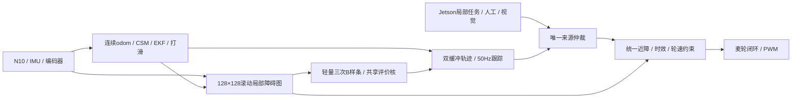

# 小车新架构开发说明

当前为未完成的研究原型。这里只描述本轮目标与继续开发边界，不保留旧方案或旧验证结论。实际落盘、已知问题和接手顺序见[handoff](handoff.md)。

## 系统范围

BX72 / GW5AT-138C连接N10、IMU660RC、四轮编码器、麦轮电机和OV5647。FPGA与Jetson、Jetson与PC服务均沿用现有UDP接入。当前小车只保留UDP；网页的退役通信入口仍待清完。

本轮只做局部定位、滚动局部障碍图、局部目标和轻量规划，不做全局地图、全局SLAM或全局路线。保留厂商IP、OV5640参考及OV5647/ISP视频网络通路。

## FPGA目标

- 复用传感器、编码器、麦轮里程计、CSM/EKF与打滑处理。定位匹配参考需持续更新，odom保持连续；参考generation不等于odom域。
- 局部障碍图128×128、64mm/格，包含整圈扫描缓存、位姿/源时标对齐、射线free与hit、未知区、滚动窗口、膨胀、版本一致快照。图与定位匹配参考独立。
- 约10控制点的二维三次B样条，最多3初值，4～6轮有界坐标搜索。优先由有效旧轨迹连续重建初值，必要时直达/两侧偏移；初值、微调与最终硬检查共用一条采样/地图查询/乘加链。
- 不引入完整EGO、L-BFGS、Hessian、全局ESDF、通用浮点求解器、独立局部A*或软核。
- 平移保持给定车体航向，麦轮支持横移；终点转向单列。最终轨迹检查完整车体扫掠、未知/边界、各轮速度/加速、时效和溢出；容量不足必须拒绝或缩短时域，不漏检后成功。
- 轨迹双缓冲、连续交接、短段执行与滚动重规划。无合格轨迹停车受阻；旧轨迹只有仍有效且在当前地图完整复查合格才能沿用。
- 人工、视觉、协同与独立任务都进入统一近障/运动入口。独立局部任务不能依赖Jetson逐周期提供初值、梯度或回弹约束。
- 视频DDR双缓冲仍使用唯一DDR控制器，规划工作集优先片上RAM。保留持续AWB、降噪、Gamma、800×480 YUYV PT97及网络遥测。

## Jetson和网页目标

在当前ugv_bridge单网关中接通完整LaserScan、轮式里程计、已融合雷达的位姿、odom→base_link TF与源时间映射，避免把同一雷达信息重复作为独立观测融合。

Jetson下发odom坐标局部目标和任务，处理模式、回执、到点/受阻/取消状态；网页沿用既有UDP6200服务，不另加争用端口的网关。不运行与FPGA争夺最终运动控制权的ROS局部控制器。

TensorRT、ByteTrack、目标选择、丢失处理与视觉转向保留。没有可靠测距时，不用框大小伪造距离或自主接近能力。

## 模式与公共合同

| 模式 | 失效行为 |
| --- | --- |
| 人工/视觉 | 速度请求200ms过期停车 |
| 协同局部任务 | 未明确许可断链续行则停车；许可也只到任务有效期 |
| 独立局部任务 | 不依赖网络心跳，仍受定位/传感器/期限/可行轨迹约束 |

人工接管、停止、取消、odom重置使旧任务失效。不能让未选中的零速心跳覆盖正在执行的任务。

坐标、Q16位宽、舍入、溢出、ready/valid、64位源时间、地图原点/版本、odom域、任务编号及72字节任务分片定义集中在[公共接口](refactor_20261024/接口与文件归属.md)，其他线程不另猜字段。

## 实施和验证

主线程+A/B/C四路，统一lunamax=`gpt-6-luna/max`，一文件一个写入者，子线程不派生。研究原型优先正确、可调试、简单可读；文档和契约注释用简体中文。

目标是50MHz规划域、10Hz规划和50Hz跟踪/轮速；新增Logic≤12000、BSRAM≤48、DSP≤24只是压缩目标，没有本轮资源或吞吐验证。

全部产品/测试/配置/文档完成，主线程停止并发写入、集成、保存并记录HEAD和输入指纹后，才统一离线测试。代码未完成时禁止测试、仿真、回放、lint、语法检查、编译/elaboration。本次中途交接没有测试冻结或通过结果。

本轮禁止综合、PNR、IP重生成、烧录、Flash、实板采集和电机动作。